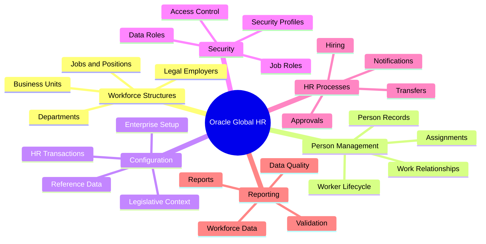
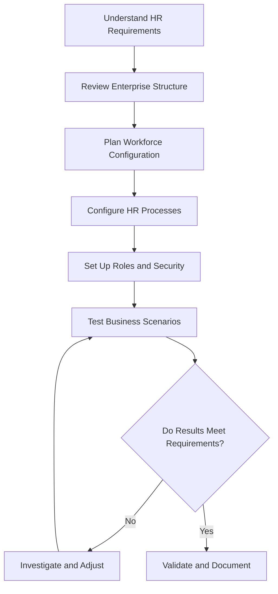

 Oracle 1Z0-1046-26: Global Human Resources Cloud 2026 Implementation Professional

Preparing for the Oracle Global Human Resources Cloud 2026 Implementation Professional (1Z0-1046-26) exam? This repository brings together useful study guidance, Core HR concepts, implementation topics, and practice resources to help make your preparation more organized.

Whether you're building your Oracle HCM knowledge or reviewing key implementation concepts, use this guide to structure your learning and identify areas that need more attention.

Explore additional preparation resources:[CertsGate — Oracle 1Z0-1046-26](https://certsgate.com/exams/oracle/1z0-1046-26)

---

 Table of Contents

- [Exam Overview](exam-overview)
- [Who Is This Guide For?](who-is-this-guide-for)
- [Key Study Areas](key-study-areas)
- [Global HR Concept Map](global-hr-concept-map)
- [Conceptual HR Implementation Workflow](conceptual-hr-implementation-workflow)
- [Study Roadmap](study-roadmap)
- [Practice Checklist](practice-checklist)
- [Practice Questions](practice-questions)
- [Common Preparation Mistakes](common-preparation-mistakes)
- [Frequently Asked Questions](#frequently-asked-questions)
- [Official Resources](#official-resources)
- [About CertsGate](#about-certsgate)
- [Disclaimer](#disclaimer)

---

 Exam Overview

The 1Z0-1046-26 exam is associated with Oracle Global Human Resources Cloud 2026 Implementation Professional certification.

Oracle Global Human Resources (Global HR) is part of Oracle Fusion Cloud Human Capital Management (HCM). It supports organizations in managing workforce information and HR processes across their business.

| Detail | Information |
|---|---|
| Exam code | 1Z0-1046-26 |
| Exam area | Oracle Global Human Resources Cloud |
| Product family | Oracle Fusion Cloud HCM |
| Main focus | Global HR implementation and configuration |
| Preparation approach | Official learning materials, configuration concepts, and scenario-based practice |

Check Oracle's official certification information for the latest exam format, objectives, duration, and registration requirements.

---

Who Is This Guide For?

This guide may be useful for:

- Oracle Fusion Cloud HCM consultants.
- HR technology professionals.
- Global HR implementation teams.
- Functional consultants learning Core HR configuration.
- HR administrators developing their Oracle Cloud skills.
- Certification candidates looking for a structured revision plan.

Basic knowledge of HR processes and enterprise applications can be helpful. If you're new to Oracle HCM, start with the fundamentals before moving into implementation scenarios.

---

Key Study Areas

Use the following topics as a starting point. Confirm the exact objectives against Oracle's current official exam guide.

 1. Workforce Structures

Learn how organizations represent their workforce and reporting relationships.

- Legal entities and legal employers.
- Business units and departments.
- Locations and jobs.
- Positions and grades.
- Organization structures and hierarchies.

 2. Workforce Person Management

Review the concepts used to maintain employee and worker information.

- Person records and work relationships.
- Employment and assignment information.
- Hire and transfer processes.
- Worker lifecycle changes.
- Personal and employment information management.

 3. Global HR Configuration

Understand the purpose of key configuration choices in an Oracle HCM implementation.

- Enterprise and workforce setup.
- Reference data and common configuration concepts.
- Legislative and country-specific considerations.
- HR transaction processes.
- Configuration dependencies.

 4. Security and Roles

Learn how access to HR information and functions is managed.

- Job roles and abstract roles.
- Data roles and security profiles.
- Role assignments.
- Access to workforce records.
- Least-privilege principles.

5. HR Processes and Approvals

Explore how HR transactions move through an organization.

- Hire and employment changes.
- Approval workflows.
- Transaction responsibilities.
- Notifications and review processes.
- Troubleshooting common workflow issues.

6. Reporting and Data Management

Review how HR information is accessed and maintained.

- Workforce data quality.
- Reporting concepts.
- Data validation.
- Import and maintenance processes.
- Common implementation troubleshooting.

These are general learning categories, not a substitute for Oracle's published skills-measured list.

---

 Global HR Concept Map

Use this map to organize your notes and connect each topic to practical HR business requirements.

---

 Conceptual HR Implementation Workflow

The following diagram illustrates a simplified implementation approach. It is a learning aid, not an official Oracle implementation sequence.

Why this workflow matters

A successful implementation requires more than knowing individual features. You should understand how organizational structures, worker records, security, and HR transactions work together.

---

 Study Roadmap

This suggested four-week schedule can help you divide your preparation into manageable sections. It is not an official Oracle study timetable.

| Week | Focus | Suggested activities |
|---|---|---|
| Week 1 | HR fundamentals and workforce structures | Review legal employers, business units, departments, jobs, and positions |
| Week 2 | Person and employment management | Study worker records, work relationships, assignments, and lifecycle changes |
| Week 3 | Configuration, security, and workflows | Review configuration dependencies, roles, security profiles, and approvals |
| Week 4 | Reporting and revision | Review data management, practice scenarios, and revisit weak areas |

 Daily study routine

1. Choose one topic from the official exam objectives.
2. Read the relevant Oracle learning material.
3. Write a short explanation in your own words.
4. Connect the concept to a realistic HR scenario.
5. Answer practice questions.
6. Review mistakes and revisit unclear topics.

---

Practice Checklist

Use this checklist to track your progress.

- [ ] Explain the purpose of legal employers and business units.
- [ ] Distinguish jobs, positions, departments, and grades.
- [ ] Understand person records and work relationships.
- [ ] Review worker hiring and transfer scenarios.
- [ ] Understand common Global HR configuration concepts.
- [ ] Review the purpose of roles and security profiles.
- [ ] Understand how HR transactions and approvals work.
- [ ] Review data quality and reporting concepts.
- [ ] Practise explaining configuration decisions.
- [ ] Check the latest official exam objectives before the exam.

Where possible, use an authorized Oracle training environment. Do not make changes to production systems without appropriate authorization.

---
 Practice Questions

Practice questions help you check your understanding and identify topics that need more revision.

Example question

Scenario: An organization needs to represent a department within its workforce structure in Oracle Fusion Cloud HCM.

Which type of configuration should the consultant investigate?

A. Department configuration  
B. Storage redundancy  
C. Network security group rules  
D. Database backup retention  

Answer:A. Department configuration.

Explanation:** Departments are part of workforce structures used to organize people and work within an enterprise.

This is an illustrative learning question, not an official Oracle exam question.*

For additional exam preparation material, visit [CertsGate — 1Z0-1046-26](https://certsgate.com/exams/oracle/1z0-1046-26).

---

 Common Preparation Mistakes

- Memorizing terms without understanding their business purpose.
- Confusing jobs, positions, departments, and legal employers.
- Overlooking the relationship between workforce structures and worker records.
- Ignoring security roles and data access.
- Studying HR workflows without understanding approvals.
- Using outdated study materials without checking current objectives.
- Treating practice questions as a replacement for official documentation.

Focus on understanding how configuration choices support real HR requirements.

---

 Frequently Asked Questions

 What is the 1Z0-1046-26 exam?

It is associated with Oracle Global Human Resources Cloud 2026 Implementation Professional certification.

 What should I study?

Start with the official exam objectives, then review workforce structures, person management, Global HR configuration, security, HR transactions, and related reporting concepts as applicable to the current exam guide.

 Is practical experience useful?

Yes. Practical configuration experience can help you understand how Oracle HCM features work together to support HR processes.

Where can I find additional preparation resources?

Start with Oracle's official learning resources and explore the relevant preparation page on [CertsGate](https://certsgate.com/exams/oracle/1z0-1046-26).

 Does this guide guarantee a passing score?

No. It is a study aid and does not guarantee certification results.

---

 Official Resources

Use official Oracle resources to verify the current exam details and product documentation.

- [Oracle Certification and Training](https://education.oracle.com/)
- [Oracle Learning](https://learn.oracle.com/)
- [Oracle Cloud Applications Documentation](https://docs.oracle.com/en/cloud/saas/)
- [Oracle Help Center](https://docs.oracle.com/)

Confirm the exact 1Z0-1046-26 exam objectives and requirements on Oracle's official website before relying on any third-party study guide.

---

About CertsGate

[CertsGate](https://certsgate.com/) offers IT certification preparation resources for learners working toward professional technology certifications.

Explore the dedicated page for this exam:

[Oracle 1Z0-1046-26 Preparation Resources](https://certsgate.com/exams/oracle/1z0-1046-26)

Use supplementary preparation material alongside official documentation, practical learning, and regular revision.
